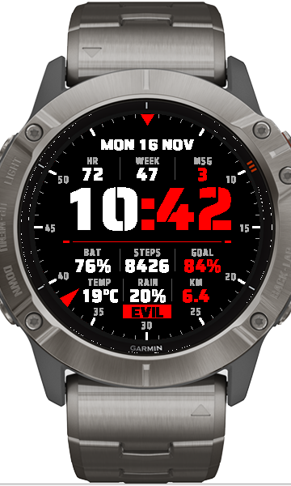

# EVIL — watch face for Garmin fēnix 6X

A military-style data face for the Garmin fēnix 6X Pro / Sapphire (280×280, 64-colour MIP display). Two-tone stencil time, a red chrono seconds marker on the minute bezel, and nine live data fields.

It is a Connect IQ port of the [Wear OS EVIL face](https://github.com/hackthecode/evil-watchface), reworked for a reflective display that has to stay readable without the backlight.

<p align="center"></p>

The screenshot is from the Connect IQ simulator, with fixed sample values.

## What it shows

| Row | Fields |
| --- | --- |
| Top | date · heart rate · week number · unread notifications |
| Centre | time (follows the 12/24 h system setting) |
| Middle | battery · steps · step goal % |
| Bottom | temperature · chance of rain · distance walked |

Values change colour with their state: heart rate is white under 100, amber from 100 and red from 140; the message count is red only while something is unread; the battery label turns into CHG on the charger and the value goes red at 20 % or less. Temperature and distance follow the watch's unit settings.

The seconds marker is drawn only while the watch is awake (for a few seconds after a wrist turn). In low-power mode the face redraws once a minute.

## What changed for the MIP display

- Hours and data values are pure white instead of grey: grey sinks on a reflective panel in dim light.
- Every colour is a pure palette value (each channel `00`/`55`/`AA`/`FF`), so nothing is dithered.
- Red reflects less light than white on this panel, so it is kept for large or bold elements: the minutes, the name plate and the right-hand column.
- No background grid or corner brackets: dark grey lines cost contrast.
- The bezel has no 55 and 5: they collided with the date at this size.

## How it is built

Monkey C, drawn entirely in code (`source/EvilView.mc`) with four custom bitmap fonts.

- `tools/gen-fonts.ps1` rasterises the TTFs in `tools/fonts-src` into BMFont files under `resources/fonts`. Edit the script, not the `.fnt` files.
- `build.ps1` compiles `bin\Evil.prg` with the Connect IQ SDK.

```powershell
.\build.ps1             # build bin\Evil.prg
.\build.ps1 -Install    # build + copy to the connected watch
```

Requires the Connect IQ SDK with the fēnix 6X Pro device files (installed through Garmin's SDK Manager), a JDK on `PATH`, and a developer key in the project root:

```
openssl genrsa -out developer_key.pem 4096
openssl pkcs8 -topk8 -inform PEM -outform DER -in developer_key.pem -out developer_key.der -nocrypt
```

## Install

Grab `Evil.prg` from [Releases](../../releases), connect the watch over USB and copy the file into `GARMIN\Apps`. Unplug the watch, hold the middle-left button, open **Watch Face** and pick **EVIL**.

The release is built for the fēnix 6X Pro / Sapphire / Pro Solar (`fenix6xpro`) only.

Fonts: Saira Stencil One and Saira Condensed, both under the SIL Open Font License (licence texts in `tools/fonts-src`).
